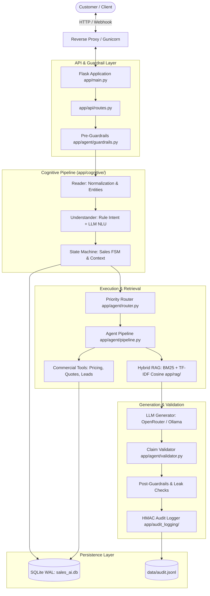
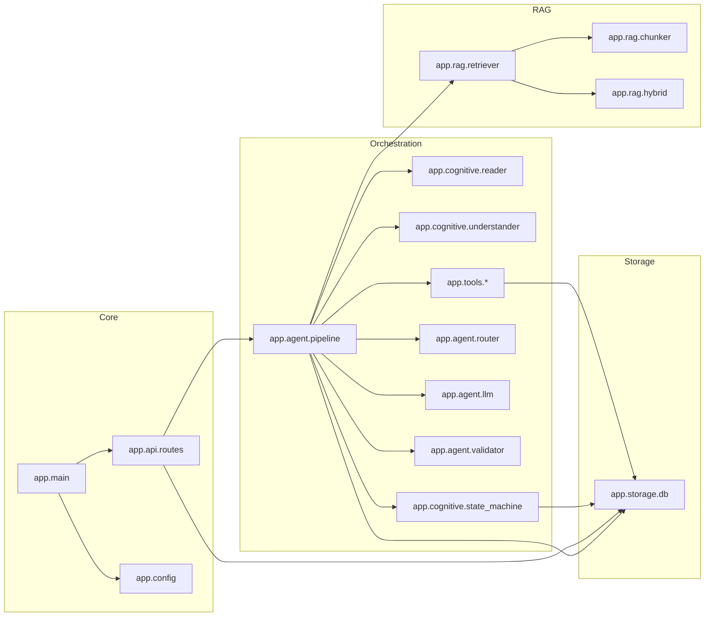
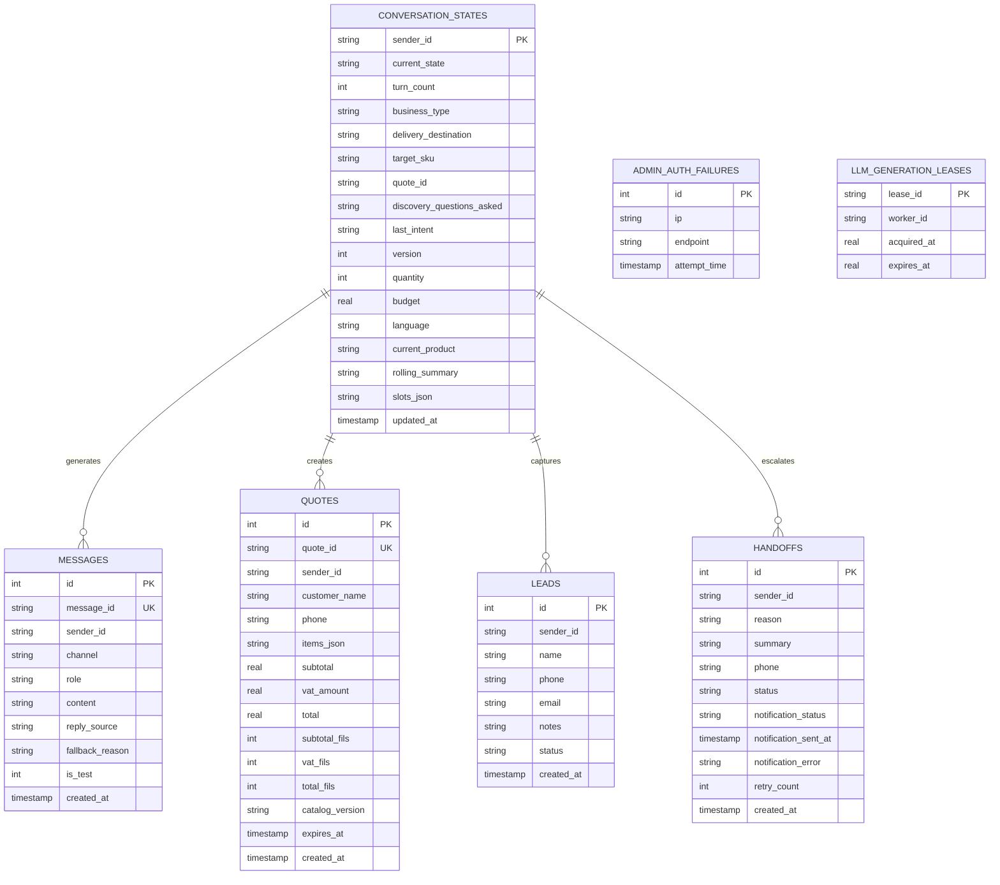
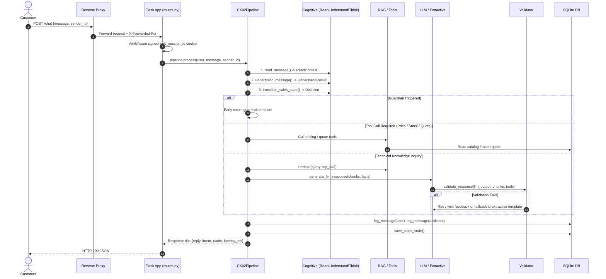
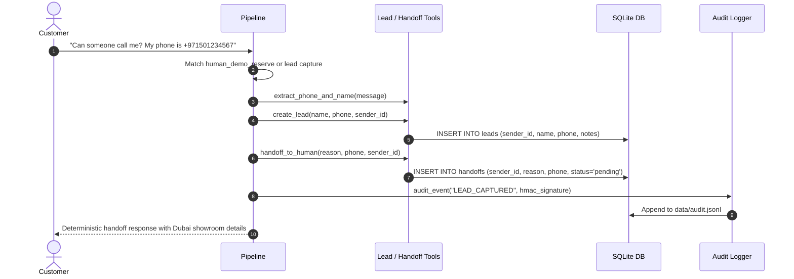

# 01_ARCHITECTURE.md - System Architecture & Structural Analysis

## 1. Architectural Style & High-Level Design
The **Kepler Tech CX-02 Sales AI** system is architected as a **Dual-Track Cognitive Sales Agent** combining deterministic finite-state rule processing with retrieval-augmented generation (RAG) and large language model (LLM) phrasing.

### Architectural Archetype
* **Style:** Layered Modular Monolith with Finite State Machine (FSM) & Dual-Track Arbitration.
* **Process Model:** Synchronous WSGI web application served by Gunicorn (`2` worker processes in production) with SQLite WAL database.
* **Core Philosophy (Hard Rules 1 & 2):** Strict commercial separation of authority. The LLM is strictly forbidden from inventing prices, stock, delivery, or warranty data. All commercial figures originate deterministically from canonical data files (`data/products.json`, `data/policies.json`) via tools, validated claim-by-claim by `app/agent/validator.py`.

---

## 2. Module Dependency Graph & Coupling Analysis

### Layering Violations & Circular Risks
1. **Monolithic God-Module (`app/agent/pipeline.py`):**
   * Spans **2,245 lines** and 158 KB.
   * Directly imports across almost every layer: `app.agent.router`, `app.agent.validator`, `app.agent.guardrails`, `app.cognitive.*`, `app.rag.*`, `app.storage.*`, `app.tools.*`, and `app.whatsapp.*`.
   * Directly handles pricing calculations, discount negotiation policies, RAG fallback formatting, lead generation, conflict resolution, and UI cards generation.
2. **Circular Dependency Mitigations:**
   * Deferred inline imports (`from app.tools.quote import create_quote` inside route functions or methods) are used extensively across `app/api/routes.py` (e.g. lines 231, 342, 370, 402, 433) and `app/agent/pipeline.py` to prevent cyclic import deadlocks at boot time.
3. **Double Storage Boundary:**
   * Conversation state is saved in both `conversation_states` table (via `app/cognitive/state_machine.py`) and `messages` table (via `app/storage/messages.py`) without a unified database transaction.

---

## 3. External Integrations & Boundaries
| Integration | Module / File | Transport / Protocol | Authentication | Timeout / Failover |
| :--- | :--- | :--- | :--- | :--- |
| **OpenRouter LLM API** | `app/agent/llm.py:34-58` | HTTPS POST JSON | Bearer token (`OPENROUTER_API_KEY`) | 15.0s timeout; falls back to local Ollama |
| **Ollama Local LLM** | `app/agent/llm.py:59-78` | HTTP POST JSON | None (localhost:11434) | 15.0s timeout; falls back to extractive template |
| **Meta WhatsApp API** | `app/whatsapp/client.py` | HTTPS POST Graph API | Bearer token (`WHATSAPP_TOKEN`) | Fail-closed in prod if secret missing |
| **SQLite WAL DB** | `app/storage/db.py` | Local filesystem POSIX | File permissions (600/644) | 15.0s busy_timeout with WAL journal |
| **Prometheus Metrics**| `app/api/routes.py:221-228`| HTTP GET | Protected by Bearer `ADMIN_API_KEY` | In-memory atomic counters |

---

## 4. Entity-Relationship (ER) Diagram

---

## 5. End-to-End Runtime Sequence Flows

### Flow A: Inbound Customer Chat Request (/chat)

### Flow B: Specialist Handoff & CRM Lead Capture

