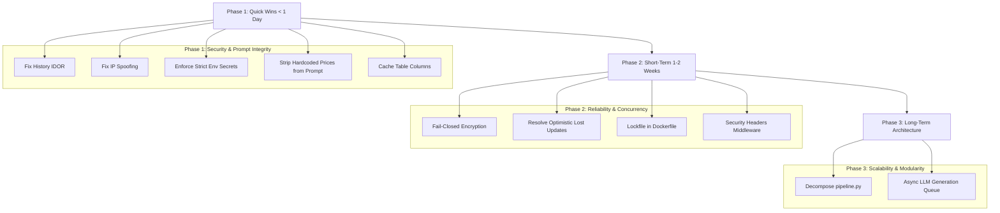

# 05_ROADMAP.md - Strategic Remediation Roadmap

---

## Phase 1: Quick Wins (< 1 Day Effort)
* [ ] **SEC-01: Remove unverified `sender_id` bypass in `/history` and `/history/export`.**
  * *Files:* `app/api/routes.py:389-400, 423-432`
  * *Action:* Only allow `sender_id` parameter override when `is_admin == True`.
* [ ] **SEC-02: Sanitize IP extraction in `get_client_ip()`.**
  * *Files:* `app/api/routes.py:37-41`
  * *Action:* Use `request.remote_addr` (properly populated by `ProxyFix`).
* [ ] **SEC-03: Enforce fail-closed startup configuration.**
  * *Files:* `app/config.py:validate_config()`
  * *Action:* Prevent boot if `ADMIN_API_KEY` or `PII_ENCRYPTION_KEY` match default fallback constants in production.
* [ ] **AI-01: Remove hardcoded commercial prices from LLM System Prompt.**
  * *Files:* `app/agent/llm.py:25`
  * *Action:* Keep prompt generic; rely strictly on `structured_facts` payload.
* [ ] **PERF-02: Remove per-turn `PRAGMA table_info` queries.**
  * *Files:* `app/storage/messages.py:32, 74`
  * *Action:* Store known table schema columns in a module constant.

---

## Phase 2: Short-Term Hardening (1–2 Weeks Effort)
* [ ] **SEC-04: Fail-closed field encryption.**
  * *Files:* `app/utils/crypto.py:46-48`
  * *Action:* Throw `CryptoError` on encryption failure rather than returning plaintext.
* [ ] **DATA-01: Fix Lost Update in `conversation_states`.**
  * *Files:* `app/cognitive/state_machine.py:205-210`
  * *Action:* Implement selective slot merging on version collisions before retrying.
* [ ] **OPS-01: Pin Docker dependencies to lockfile.**
  * *Files:* `Dockerfile`
  * *Action:* Update container build to run `pip install -r requirements.lock`.
* [ ] **OPS-02: Register HTTP Security Headers.**
  * *Files:* `app/main.py`
  * *Action:* Add `@app.after_request` adding `X-Frame-Options: DENY`, `X-Content-Type-Options: nosniff`, and `Content-Security-Policy`.

---

## Phase 3: Long-Term Architectural Evolution (> 2 Weeks Effort)
* [ ] **ARCH-01: Decompose `app/agent/pipeline.py` Monolith.**
  * *Action:* Refactor into modular pipeline handlers:
    * `app/agent/handlers/pricing_handler.py`
    * `app/agent/handlers/technical_rag_handler.py`
    * `app/agent/handlers/lead_capture_handler.py`
    * `app/agent/handlers/handoff_handler.py`
* [ ] **PERF-01: Asynchronous Non-Blocking LLM Dispatch.**
  * *Action:* Transition LLM calling to an asynchronous queue (Celery or background worker) or native SSE streaming to avoid starving Gunicorn WSGI threads.
