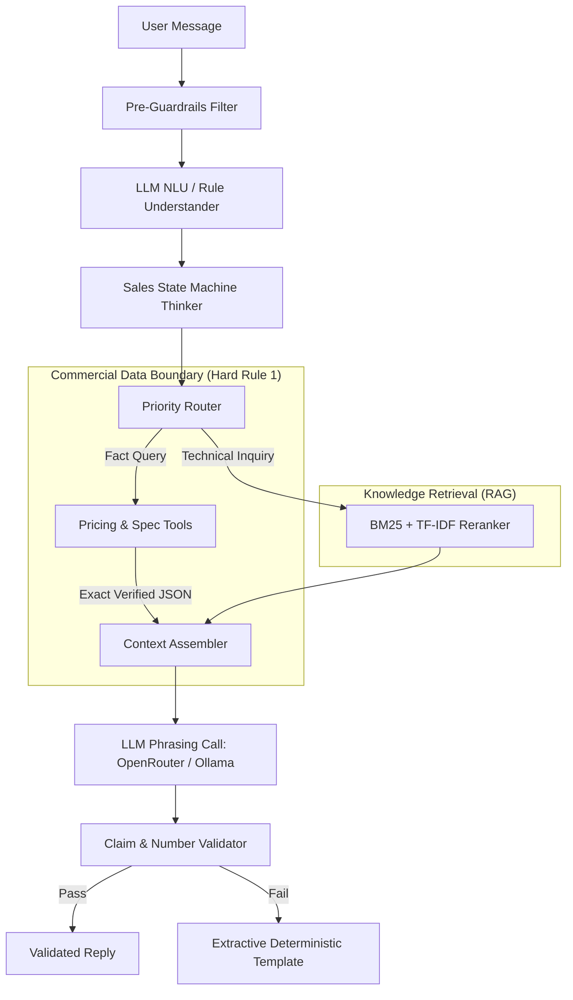

# 08_AI_REPORT.md - AI, LLM, RAG & NLP Systems Audit

## 1. AI Touchpoint Inventory & Architecture
* **Primary Cloud Model:** OpenRouter API (`https://openrouter.ai/api/v1`) using `meta-llama/llama-3.3-70b-instruct` (`app/config.py:39`).
* **Fallback Local Model:** Ollama API (`http://localhost:11434`) using `qwen2.5:7b` (`app/config.py:42`).
* **Embedding Model:** Ollama `nomic-embed-text` (`app/config.py:43`) combined with BM25 Okapi (`rank-bm25`) and TF-IDF Cosine reranking (`app/rag/hybrid.py`).
* **Orchestration Paradigm:** Deterministic State Machine + Extractive Tool Grounding + LLM Semantic Phrasing.



---

## 2. Complete Prompt Inventory

### Prompt 1: LLM Phrasing System Prompt
* **Location:** `app/agent/llm.py:10-26`
* **Purpose:** Instructs the LLM on persona, brevity, and grounding constraints.
* **Text Extract:**
  ```text
  You are the official Kepler Tech sales consultant for Kepler Tech LLC (Dubai)...
  STRICT FACTUAL CONSTRAINTS:
  1. Answer ONLY using the verified facts and retrieved context chunks provided below.
  2. If the context does not explicitly contain the answer, reply with 'NO_ANSWER'.
  3. NEVER guess, estimate, or invent numbers, dimensions, speeds, weights, warranties...
  6. When stating prices or yields, quote the exact figures from the verified facts...
  ```
* **Critical Finding (Hard Rule Violation):**
  * Line 25 contains hardcoded price strings: `4,385.00 AED for CX-02, 490.00 AED for 4x6 media, 500.00 AED for 5x7 media...`.
  * Violates Hard Rule 1 (commercial authority strictly from tools) and Hard Rule 4 (configuration-driven scope).

### Prompt 2: Structured NLU Extraction Prompt
* **Location:** `app/cognitive/understander.py:299-327`
* **Purpose:** Forces JSON schema output for intent, sentiment, business type, and risk flags.
* **Schema Definition:**
  ```json
  {
    "primary_intent": "string",
    "sub_intent": "string or null",
    "commercial_readiness": "high" | "medium" | "low",
    "business_type": "photobooth" | "studio" | "freelance" | "kiosk" | "event" | "unknown",
    "delivery_destination": "UAE" | "GCC" | "outside_gcc" | null,
    "sentiment": "positive" | "neutral" | "negative" | "frustrated",
    "urgency": "urgent" | "normal",
    "risk_flags": {
      "competitor_mentioned": boolean,
      "churn_risk": boolean,
      "anger_frustration": boolean,
      "legal_threat": boolean,
      "prompt_injection": boolean
    }
  }
  ```

---

## 3. OWASP Top 10 for LLM Applications Mapping

| OWASP LLM ID | Vulnerability Category | Repository Implementation Status & Finding | Severity |
| :--- | :--- | :--- | :--- |
| **LLM01** | Prompt Injection | **Protected (Dual Gate):** Pre-guardrail regex patterns (`app/agent/guardrails.py:10-52`) check for system prompt extraction, jailbreaks, and delimiter bypass. Post-guardrail checks output. | **Low** |
| **LLM02** | Insecure Output Handling | **Protected:** Output validator (`app/agent/validator.py:52-120`) scans for ungrounded numbers, prices, and banned claims. Falls back to extractive template. | **Low** |
| **LLM03** | Training Data Poisoning | **Not Applicable:** No model training or fine-tuning performed on customer data. | **Info** |
| **LLM04** | Model Denial of Service | **Vulnerable:** Admission queue (`app/agent/admission.py`) uses DB leases, but HTTP requests block WSGI threads for 15s. Burst traffic can exhaust Gunicorn workers. | **Medium** |
| **LLM05** | Supply Chain Risks | **Medium Risk:** Unpinned OpenRouter model string `meta-llama/llama-3.3-70b-instruct` can change underlying weights without notice. | **Low** |
| **LLM06** | Sensitive Information Disclosure | **Protected:** PII masking (`mask_phone_number`), field encryption for messages, system prompt leak detection regexes in post-guardrails. | **Low** |
| **LLM07** | Insecure Plugin Design | **Protected:** Tools (`pricing.py`, `quote.py`, `leads.py`) are strictly parameter-checked and have no arbitrary shell/network access. | **Low** |
| **LLM08** | Excessive Agency | **Protected:** Tools cannot execute financial transactions, send unsolicited external messages, or delete data. | **Low** |
| **LLM09** | Overreliance | **Protected:** Deterministic circuit breaker and dual-track arbitration strictly overrides LLM outputs on commercial data. | **Low** |
| **LLM10** | Model Theft | **Not Applicable:** Uses public third-party APIs and open-weight local models. | **Info** |

---

## 4. RAG Quality & Ingestion Pipeline
* **Chunking Strategy:** Structured Markdown splitting by header section (`app/rag/chunker.py`) with metadata tagging (`model`, `section`, `category`, `source_file`).
* **Chunk Size:** Average chunk size ~180-350 tokens, focused on single technical specifications or policies.
* **Retrieval Method:** Hybrid retrieval combining BM25 keyword matching with TF-IDF cosine similarity vector reranking (`app/rag/hybrid.py:40-95`).
* **RAG Limitations:**
  1. No persistent vector database (e.g. ChromaDB, Qdrant); index is rebuilt or loaded in-memory from JSON on startup.
  2. TF-IDF vector space vocabulary is computed at runtime and lacks semantic synonym expansion for unstemmed multilingual terms.
