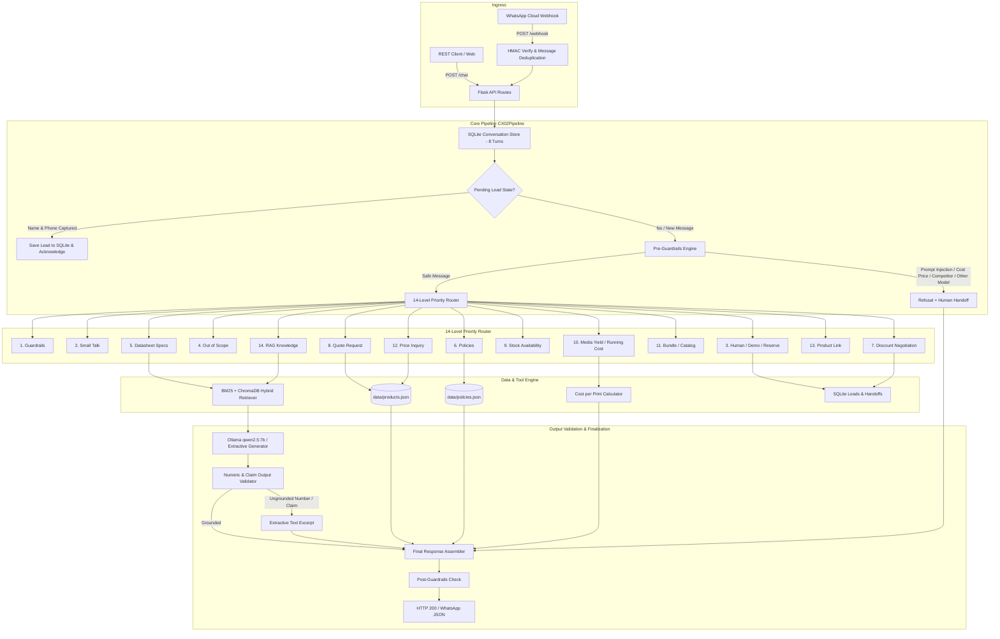

# Architecture & System Design: cx02-sales-ai

## 1. Executive Summary
**cx02-sales-ai** is a production sales assistant dedicated exclusively to the **Citizen CX-02 dye-sublimation photo printer** and its official accessories, distributed by **Kepler Tech LLC (Dubai)**.

The system is designed with zero-tolerance for hallucinations:
1. **Commercial Data Authority**: All prices, stock, product links, company policies, and quote calculations are computed strictly in code reading from `data/products.json` and `data/policies.json`.
2. **Strict Guardrails**: Politely refuses and hands off inquiries regarding other printer models (e.g., `CX-02W`, `CY-02`, `CZ-01`) or competitor brands (`DNP`, `Fuji`, `HiTi`, `Sinfonia`, `Mitsubishi`, `Epson`, `Canon`).
3. **Output Validator**: Scans all LLM responses for ungrounded numbers or claims. If found, substitutes an exact extractive context summary.
4. **Resilient Dual Mode**: Operates in full LLM mode via Ollama (`qwen2.5:7b`), and falls back seamlessly to extractive mode with no crashes if Ollama is unavailable.

---

## 2. End-to-End System Architecture

---

## 3. 14-Level Priority Routing Hierarchy

| Priority | Intent | Description | Action / Handler |
|---|---|---|---|
| **1** | `guardrails` | Prompt injection, `"cost price"` extraction, abuse, competitor brands, other Citizen models, A4 paper | Immediate polite refusal + human referral |
| **2** | `small_talk` | Greetings, farewells, gratitude ("hi", "bye", "thanks") | Fixed brand greeting template |
| **3** | `human_demo_reserve` | Requests to talk to a person, book a showroom demo, or reserve a unit | Capture contact details + handoff to Kepler team |
| **4** | `out_of_scope` | Inquiries on unrelated topics (TVs, cars, crypto, weather) | Polite refusal noting exclusive CX-02 scope |
| **5** | `datasheet` | Technical specifications (resolution, speed, weight, rewind, drivers) | Hybrid RAG retrieval from datasheet chunks |
| **6** | `policies` | Commercial policies (delivery charges, payment methods, returns, installation) | Checks `data/policies.json`; null values trigger handoff |
| **7** | `discount_negotiation` | Requests for discount codes, bargaining, or wholesale terms | Handoff to human corporate sales desk |
| **8** | `quote` | Formal quotation request for specified quantities | Deterministic code quote calculation with 1–1000 quantity validation |
| **9** | `stock` | Inventory availability check for Dubai warehouse | Reads stock status from `data/products.json` |
| **10** | `media_yield_cost` | Consumable cost per print and box print yields | Calculates exact AED per print with estimate labeling |
| **11** | `bundle_catalog` | Catalog browsing and accessory range questions | Returns formatted list of all whitelisted products |
| **12** | `price` | Product pricing inquiries | Returns canonical AED pricing with `as_of` date verification |
| **13** | `link` | Purchase URL and official Kepler store links | Returns official product web page URLs |
| **14** | `rag` | General technical inquiries regarding Citizen Systems heritage or CX-02 | Hybrid RAG retrieval with dual relevance gating |

---

## 4. Grounding & Output Validation Engine

To eliminate hallucinations:
1. **Data Freshness**: Prices carry an `as_of` date. If older than `PRICE_MAX_AGE_DAYS` (default 14 days), the system appends a freshness confirmation notice.
2. **Conditional VAT**: VAT calculations are omitted unless both `VAT_RATE` and `PRICES_INCLUDE_VAT` are explicitly defined in the environment.
3. **Yield Estimation Transparency**: Consumable yields for 4x6" and 6x8" media sets are explicitly labeled as estimates, while 5x7" is labeled as verified.
4. **Number and Claim Verification**: `app/agent/validator.py` extracts every numeric figure, price, percentage, and commercial claim. Any ungrounded claim triggers automatic fallback to exact extractive text.

---

## 5. Security & Webhook Handling

* **Meta Webhook Verification**: `GET /webhook` verifies `hub.mode == "subscribe"` and `hub.verify_token`.
* **HMAC-SHA256 Payload Signature**: `POST /webhook` validates `X-Hub-Signature-256` against `WHATSAPP_APP_SECRET`.
* **Idempotency & Replay Protection**: Message IDs are tracked in SQLite; duplicate messages are safely ignored while returning HTTP 200.
