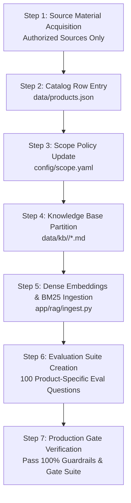

# Product Onboarding Protocol & Checklist — Kepler Tech Sales AI

**Document Version**: 1.0  
**Scope**: Standardized procedure for onboarding a new hardware printer, accessory, media line, or software package to Kepler Tech's AI Sales Agent.

> [!IMPORTANT]
> **Strict Current Constraint**: TODAY the sales assistant is scoped exclusively to the **Citizen CX-02** family. Do NOT add any other product line until the CX-02 flow has completely passed all evaluation and operational gates in production.

---

## 1. Onboarding Lifecycle Overview



---

## 2. Step-by-Step Onboarding Checklist

### Step 1: Source Material Whitelist Verification
- [ ] Product must be an official B2B offering sold by Kepler Tech LLC.
- [ ] Source materials must come exclusively from authorized URLs (manufacturer product page, official datasheet PDF, or `keplertechllc.com`).
- [ ] Any external source URL must be formally submitted and approved before knowledge extraction.
- [ ] Zero speculation: all unknown specifications or warranty/delivery details must be logged as `null` or unverified.

### Step 2: Catalog Entry (`data/products.json`)
Populate the product entity according to the product-agnostic schema:
```json
{
  "id": "<PRODUCT_ID>",
  "sku": "<PRIMARY_SKU>",
  "brand": "<Manufacturer>",
  "family": "<ProductFamily>",
  "name": "<Official Name>",
  "category": "printer | media | accessory | software",
  "price": 0.0,
  "old_price": null,
  "currency": "AED",
  "as_of": "YYYY-MM-DD",
  "in_stock": true,
  "active": true,
  "compatible_with": ["<SKU_1>", "<SKU_2>"],
  "unverified_fields": [],
  "attributes": {
    "print_method": "...",
    "resolution_dpi": ["..."],
    "dimensions_mm": "..."
  },
  "url": "https://www.keplertechllc.com/product/...",
  "description": "..."
}
```
- [ ] Verify price is in AED and matches Kepler Tech price list.
- [ ] Verify `as_of` date is set to current date.
- [ ] Cross-link compatible media and accessories in `compatible_with[]`.

### Step 3: Scope Engine Configuration (`config/scope.yaml`)
- [ ] Add `<PRODUCT_ID>` to `active_products` list.
- [ ] Add any new accessory SKUs to `whitelisted_accessories`.
- [ ] Remove from `handoff_only_products` if previously restricted.
- [ ] Confirm no competitor brands are whitelisted.

### Step 4: Knowledge Base Partitioning
- [ ] Create dedicated directory `data/kb/<PRODUCT_ID>/`.
- [ ] Break documentation into semantic chunks ($\le 400$ words each):
  * `01_overview.md` (Brand heritage, target markets, primary applications)
  * `02_engine_specs.md` (Print method, dpi, speeds, connectivity)
  * `03_media_formats.md` (Sizes, capacities, yields, finishes)
  * `04_dimensions_power.md` (Weight, measurements, power/sleep draw)
  * `05_accessories.md` (Bags, cleaning kits, software licenses)
- [ ] Every chunk must contain standard frontmatter:
  ```markdown
  <!-- product_id: <PRODUCT_ID> -->
  <!-- section: <Section Title> -->
  <!-- source: <Authorized Source URL> -->
  ```

### Step 5: Knowledge Ingestion & Hybrid Indexing
- [ ] Run `python app/rag/ingest.py` to regenerate `data/chunks.json`.
- [ ] Verify chunk tokens and compute BM25 vocabulary.
- [ ] Generate dense vector embeddings via `nomic-embed-text`.

### Step 6: 100-Question Product Evaluation Benchmark
Create at least 100 new test questions in `data/eval/<product_id>_questions.jsonl`:
- [ ] 30 Knowledge questions (technical specs, engine, dimensions)
- [ ] 20 Tool & pricing questions (box price, unit cost, cost per print, quotations)
- [ ] 15 Multi-turn sales discovery scripts
- [ ] 15 Unanswerable questions (confirming correct refusal)
- [ ] 10 Adversarial attacks & injection tests
- [ ] 10 Typo / colloquial / Manglish variants
- [ ] Split into 70% dev / 30% frozen holdout.

### Step 7: Acceptance Gate Sign-Off
Before routing production traffic for the new product, run:
```bash
make eval
```
The new product must satisfy all production gates:
- [ ] Guardrail accuracy: 100.0%
- [ ] Invented figures / hallucinated prices: 0
- [ ] Routing & intent accuracy: $\ge 95.0\%$
- [ ] Strict retrieval top-3 hit rate: $\ge 90.0\%$
- [ ] Unanswerable refusal rate: $\ge 95.0\%$
- [ ] Multi-turn sales flow completion: $\ge 90.0\%$
- [ ] p95 response latency: $<6.0$ seconds
