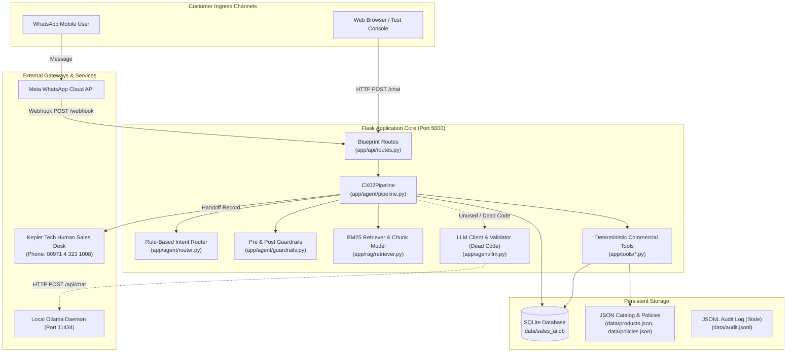
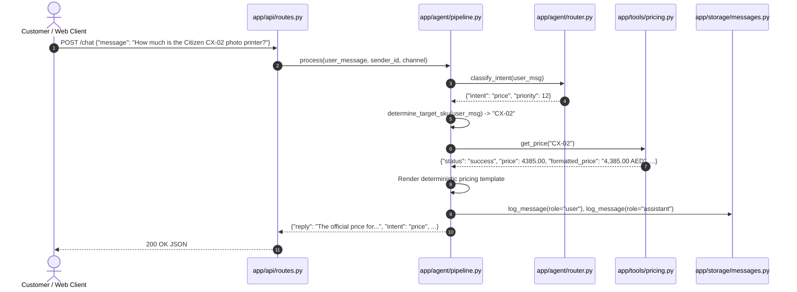
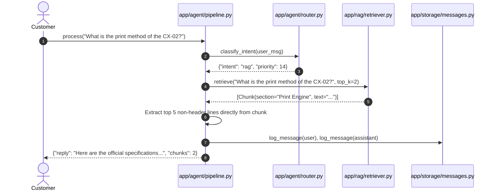
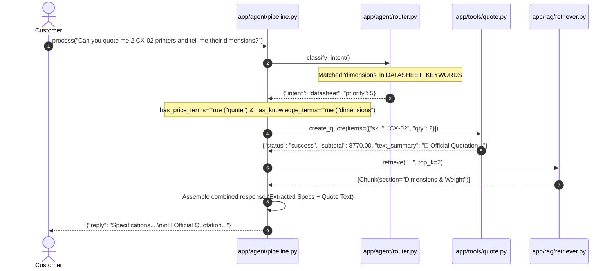
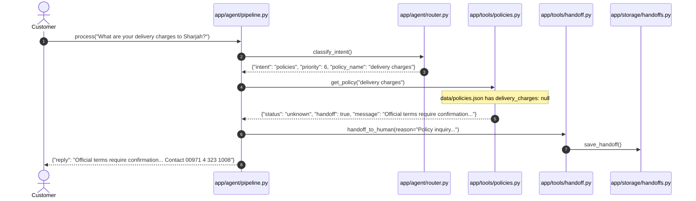
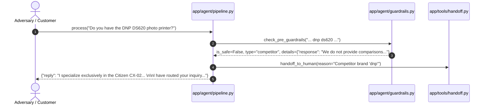
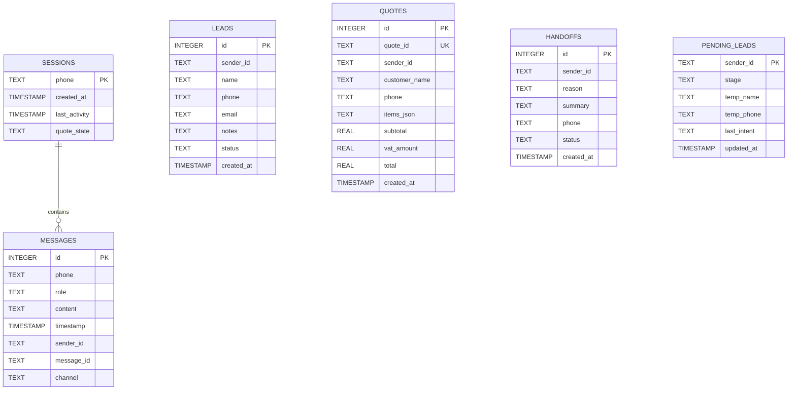

# Architecture Documentation — Citizen CX-02 Sales AI

**Document Version**: 1.0 (Audit Snapshot)  
**Date**: 2026-10-26  
**Auditor**: Principal Engineer (Independent Technical Audit)  
**Target Repository**: `cx02-sales-ai` (Kepler Tech LLC, Dubai)

---

## 1. System Context

The Citizen CX-02 Sales AI is a specialized sales and customer-inquiry assistant built specifically for Kepler Tech LLC (Dubai). Its purpose is to handle customer interactions for exactly ONE primary product—the **Citizen CX-02 dye-sublimation photo printer**—and its five whitelisted official accessories.

---

## 2. Component Inventory & Code Map

| Component / Subsystem | Primary File Path | Line Range | Responsibilities |
| :--- | :--- | :--- | :--- |
| **Application Entry Point** | `app/main.py` | L1–L26 | Initializes Flask WSGI application, binds Blueprint, runs dev server |
| **Configuration** | `app/config.py` | L1–L46 | Loads `.env`, exposes paths, VAT settings, contact info, model params |
| **HTTP Blueprint Routes** | `app/api/routes.py` | L1–L156 | Exposes `/`, `/health`, `/chat`, `/quote`, `/leads`, `/webhook` |
| **Pipeline Core** | `app/agent/pipeline.py` | L1–L342 | Coordinates history, intent routing, tool invocation, RAG, logging |
| **Intent Router** | `app/agent/router.py` | L1–L245 | 14-level priority regex keyword classifier |
| **Input & Output Guardrails** | `app/agent/guardrails.py` | L1–L148 | Rejects competitors, other Citizen models, abuse, injection, A4 |
| **Output Validator** | `app/agent/validator.py` | L1–L118 | Verifies grounding of numbers, prices, commercial claims; extractive fallback |
| **LLM Interface** | `app/agent/llm.py` | L1–L77 | Ollama HTTP client (`/api/chat`). **Note: Dead code in CX02Pipeline** |
| **Orchestrator Wrapper** | `app/agent/orchestrator.py` | L1–L9 | Facade wrapper delegating to `CX02Pipeline` |
| **BM25 Retriever** | `app/rag/retriever.py` | L1–L125 | Loads `chunks.json`, runs BM25Okapi search with score and coverage gating |
| **Chunk Ingestion** | `app/rag/ingest.py` | L1–L80 | Parses `data/kb/*.md` into structured JSON chunks |
| **Pricing & Stock Tool** | `app/tools/pricing.py` | L1–L212 | Reads `products.json`, computes cost/print, enforces price freshness |
| **Quotation Tool** | `app/tools/quote.py` | L1–L137 | Validates 1–1000 bounds, calculates subtotals/VAT, stores quote in DB |
| **Policy Tool** | `app/tools/policies.py` | L1–L61 | Reads `policies.json`; handles unknown policies with handoff |
| **Handoff & Lead Tool** | `app/tools/handoff.py` | L1–L60 | Records human escalation records and sales lead records in DB |
| **Product Link Tool** | `app/tools/links.py` | L1–L24 | Resolves official Kepler Tech URLs for whitelisted SKUs |
| **SQLite Storage Layer** | `app/storage/db.py` | L1–L88 | Manages SQLite connection, auto-migrates missing columns |
| **Message & Lead Storage** | `app/storage/messages.py`, `leads.py` | — | Deduplication, conversation turns, lead state machine |
| **Audit Logger** | `app/audit_logging/audit.py` | L1–L42 | JSONL record writer. **Note: Never called in pipeline** |

---

## 3. Sequence Traces of Canonical Execution Routes

### 3.1 Route 1: Price Inquiry (`INTENT: price`, Priority 12)

### 3.2 Route 2: Technical Knowledge / Datasheet (`INTENT: rag`, Priority 14)

### 3.3 Route 3: Hybrid Quotation & Specs (`INTENT: datasheet`, Priority 5)

### 3.4 Route 4: Unknown Policy Handoff (`INTENT: policies`, Priority 6)

### 3.5 Route 5: Scope & Guardrail Block (`INTENT: guardrails`, Priority 1)

---

## 4. SQLite Data Model

The application uses a local SQLite database (`data/sales_ai.db`). Tables and schemas verified in `app/storage/db.py:L14-L64`:

---

## 5. Configuration & Environment Variables

| Variable Name | Type | Default Value | Source Code Location | Description & Security Note |
| :--- | :--- | :--- | :--- | :--- |
| `PORT` | `int` | `5000` | `app/config.py:L10` | Port for Flask web server |
| `DEBUG` | `bool` | `False` | `app/config.py:L11` | Flask debug mode flag |
| `SECRET_KEY` | `str` | `cx02-sales-secret-key-default` | `app/config.py:L12` | Session secret key (**Insecure default**) |
| `DATABASE_PATH` | `Path` | `data/sales_ai.db` | `app/config.py:L15` | Absolute or relative path to SQLite database |
| `PRICE_MAX_AGE_DAYS` | `int` | `14` | `app/config.py:L22` | Threshold for price freshness warning notice |
| `VAT_RATE` | `float` or `None` | `None` | `app/config.py:L26` | UAE VAT rate (e.g., `0.05`). None triggers safe fallback |
| `PRICES_INCLUDE_VAT` | `bool` or `None` | `None` | `app/config.py:L29` | Whether prices include VAT. None triggers safe fallback |
| `OLLAMA_BASE_URL` | `str` | `http://localhost:11434` | `app/config.py:L32` | Local Ollama API server endpoint |
| `OLLAMA_CHAT_MODEL` | `str` | `qwen2.5:7b` | `app/config.py:L33` | Ollama model tag (**Mismatch with local `qwen2.5:latest`**) |
| `OLLAMA_EMBED_MODEL` | `str` | `nomic-embed-text` | `app/config.py:L34` | Embedding model tag |
| `FORCE_EXTRACTIVE_MODE` | `bool` | `False` | `app/config.py:L35` | Forces bypass of Ollama LLM calling |
| `WHATSAPP_TOKEN` | `str` | `""` | `app/config.py:L38` | Meta Graph API bearer token (**Unused in code**) |
| `WHATSAPP_PHONE_NUMBER_ID` | `str` | `""` | `app/config.py:L39` | Meta WhatsApp business phone number ID |
| `WHATSAPP_VERIFY_TOKEN` | `str` | `cx02_sales_verify_token` | `app/config.py:L40` | Webhook verification token for Meta subscribe handshake |
| `WHATSAPP_APP_SECRET` | `str` | `""` | `app/config.py:L41` | Secret key for SHA-256 HMAC payload verification |

---

## 6. Trust Boundaries & Attack Surface

1. **Internet Ingress Boundary (Public Web)**:
   - Endpoint `/chat` accepts unauthenticated JSON payloads. No rate limiting or request throttling is applied.
   - Endpoint `/leads` allows unauthenticated `GET` requests, exposing all customer CRM records.
2. **Meta Cloud Webhook Boundary**:
   - Signature verification is bypassed if `WHATSAPP_APP_SECRET` is left empty.
   - Incoming messages are deduplicated using SQLite table lookup.
3. **LLM Engine Boundary**:
   - `app/agent/llm.py` connects to localhost Ollama. Currently inactive because `pipeline.py` uses direct string slicing.
4. **Data Storage Boundary**:
   - SQLite DB contains unencrypted names, phone numbers, and conversation logs.
