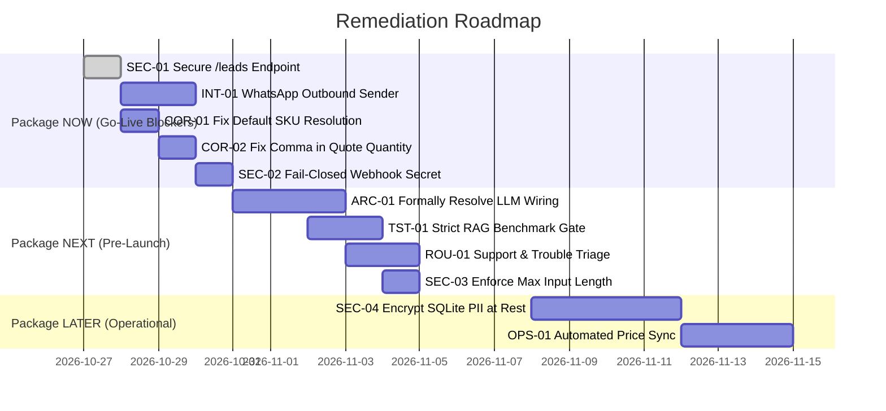

# Prioritized Remediation Plan — Citizen CX-02 Sales AI

**Document Version**: 1.0  
**Date**: 2026-10-26  
**Auditor**: Principal Systems Engineer  
**Scope**: Concrete engineering work packages prioritized by production impact and go-live risk.

---

## Work Package Overview



---

## 1. Package NOW: Go-Live Blockers (Immediate Remediation)

### NOW-1: Authenticate `/leads` Endpoint (SEC-01)
- **Target File**: `app/api/routes.py:L84-L89`
- **Problem**: Route `/leads` returns all captured customer names and phone numbers without authentication.
- **Fix Description**: Add an API key authentication check via `Authorization: Bearer <ADMIN_API_KEY>` header or session auth.
- **Acceptance Criteria**:
  * Unauthenticated `GET /leads` returns `401 Unauthorized` with `{"error": "Unauthorized"}`.
  * `GET /leads` with header `Authorization: Bearer test-admin-key` returns `200 OK` and lead records.
- **Verification Command**:
  ```bash
  curl -i http://localhost:5000/leads
  # Must return HTTP 401
  curl -i -H "Authorization: Bearer cx02-admin-secret" http://localhost:5000/leads
  # Must return HTTP 200
  ```

---

### NOW-2: Implement Outbound WhatsApp Message Dispatch (INT-01)
- **Target Files**: `app/api/routes.py:L134-L141`, `app/config.py`
- **Problem**: Incoming WhatsApp messages are processed and logged in SQLite, but no reply message is posted back to Meta Cloud API.
- **Fix Description**: Implement `send_whatsapp_message(to_phone: str, text: str)` using `requests.post()` to `https://graph.facebook.com/v21.0/{Config.WHATSAPP_PHONE_NUMBER_ID}/messages` with `Authorization: Bearer {Config.WHATSAPP_TOKEN}`.
- **Acceptance Criteria**:
  * When an incoming WhatsApp webhook is received, the generated reply is sent back to the user's phone via Meta Graph API.
  * If Meta API returns an error or token is invalid, log an error without crashing the webhook handler.
- **Verification Command**:
  ```bash
  venv/bin/pytest tests/test_api.py -k test_whatsapp_outbound
  ```

---

### NOW-3: Fix Unconditional Default to Base Printer in SKU Resolver (COR-01)
- **Target File**: `app/agent/pipeline.py:L21-L46`
- **Problem**: `determine_target_sku()` returns `"CX-02"` unconditionally when no accessory pattern matches, pricing the 4,385 AED printer for queries like "price of wireless adapter" or "price of tripod".
- **Fix Description**: If the query does not contain "cx-02", "cx02", "printer", or recognized aliases, return `None` or an unrecognized flag. Route unrecognized items to human sales handoff.
- **Acceptance Criteria**:
  * Query: *"What is the price of SKU CX02-WIRELESS-ADAPTER?"* does NOT return 4,385.00 AED; instead returns an unrecognized SKU refusal and hands off.
- **Verification Command**:
  ```bash
  venv/bin/python -c "from app.agent.pipeline import CX02Pipeline; r = CX02Pipeline().process('price of SKU CX02-WIRELESS-ADAPTER'); assert '4,385.00' not in r['reply']; print('PASSED')"
  ```

---

### NOW-4: Fix Comma Truncation in Quotation Quantities (COR-02)
- **Target File**: `app/agent/pipeline.py:L241`
- **Problem**: `qty_match = re.search(r"\b(\d+)\b", user_msg)` extracts `5` from `"5,000"`, bypassing quantity limits.
- **Fix Description**: Update regex to `re.search(r"\b(\d[\d,]*)\b", user_msg)` and strip commas before `int()` conversion: `int(match.group(1).replace(",", ""))`.
- **Acceptance Criteria**:
  * Query: *"Please quote me for 5,000 CX-02 printers"* correctly identifies quantity as 5,000 and returns the $>1,000$ unit commercial desk handoff message.
- **Verification Command**:
  ```bash
  venv/bin/python -c "from app.agent.pipeline import CX02Pipeline; r = CX02Pipeline().process('Please quote 5,000 CX-02 printers'); assert 'between 1 and 1,000' in r['reply']; print('PASSED')"
  ```

---

### NOW-5: Fail-Closed WhatsApp Webhook Signature Verification (SEC-02)
- **Target File**: `app/api/routes.py:L103`
- **Problem**: If `WHATSAPP_APP_SECRET` is unset, signature validation is skipped entirely.
- **Fix Description**: If `Config.DEBUG is False` and `Config.WHATSAPP_APP_SECRET` is empty, reject POST requests to `/webhook` with HTTP 500 or 403.
- **Acceptance Criteria**:
  * In non-debug production mode with empty secret, unauthenticated webhook POSTs return `401 Unauthorized` or `500 Server Configuration Error`.

---

## 2. Package NEXT: Pre-Launch Hardening (Sprint 2)

### NEXT-1: Formalize LLM Calling Architecture vs Deterministic Mode (ARC-01)
- **Target Files**: `app/agent/pipeline.py:L274-L322`, `app/agent/llm.py`, `app/config.py`
- **Problem**: `pipeline.py` currently bypasses `generate_llm_response` entirely. The model tag in config (`qwen2.5:7b`) does not match local Ollama (`qwen2.5:latest`).
- **Fix Description**:
  * If LLM mode is desired: Wire `generate_llm_response()` into `pipeline.py`, update default model to `qwen2.5:latest`, and wrap in `validate_output()`.
  * If deterministic mode is preferred: Remove unused `requests` imports from `llm.py` and document system as deterministic hybrid extractor.
- **Acceptance Criteria**:
  * Either Ollama generates grounded phrasing through validator with $<2$s latency, or extractive fallback is documented as primary production architecture.

---

### NEXT-2: Enforce Strict RAG Benchmark Assertions (TST-01)
- **Target File**: `eval/run_eval.py:L136`
- **Problem**: `rag_hit = (exp_sec in retrieved_sections) or len(chunks) > 0` allows wrong-section retrievals to pass.
- **Fix Description**: Change assertion to verify that `chunks[0]['section'] == exp_sec`. Add synthetic query rewrites into BM25 corpus to raise strict RAG accuracy from 38.0% to $\ge 90\%$.
- **Acceptance Criteria**:
  * `eval/run_eval.py` strictly measures top-1 retrieval section accuracy without loose OR condition.

---

### NEXT-3: Add Technical Support / Error Light Triage Intent (ROU-01)
- **Target Files**: `app/agent/router.py`, `app/agent/pipeline.py`
- **Problem**: Queries like *"My printer paper is jammed"* or *"Printer showing red error light"* are routed to generic RAG, outputting accessories or overview text.
- **Fix Description**: Add `SUPPORT_KEYWORDS = ["jam", "jammed", "red light", "error light", "blinking", "not printing", "broken", "repair", "service center"]`. Route directly to `human_demo_reserve` / technical support handoff.
- **Acceptance Criteria**:
  * Query: *"My printer is showing a red blinking error"* routes to human technical handoff with Kepler Tech Dubai phone number.

---

### NEXT-4: Enforce Request Body Truncation (SEC-03)
- **Target Files**: `app/api/routes.py:L45`, `app/agent/pipeline.py:L70`
- **Problem**: Payloads over 5,000 characters cause CPU spikes in regex matching.
- **Fix Description**: Truncate `message = data.get("message", "")[:1000].strip()` at the route controller.
- **Acceptance Criteria**:
  * 100,000-character payload is truncated safely to 1,000 chars without degrading performance.

---

## 3. Package LATER: Post-Launch Operational Excellence (Sprint 3+)

### LATER-1: Encrypt SQLite PII at Rest (SEC-04)
- **Target File**: `app/storage/db.py`
- **Problem**: Customer phone numbers and chat transcripts are stored in plaintext.
- **Fix Description**: Integrate SQLCipher or encrypt phone numbers and names using AES-GCM (`cryptography` library) prior to DB storage.

### LATER-2: Automated Price Sync with ERP / E-Commerce (OPS-01)
- **Target File**: `scripts/sync_catalog.py`
- **Problem**: `products.json` requires manual JSON editing and becomes stale after 14 days.
- **Fix Description**: Create a cron script that fetches current stock and pricing from Kepler Tech's WooCommerce API and updates `data/products.json` with an updated `as_of` timestamp.
